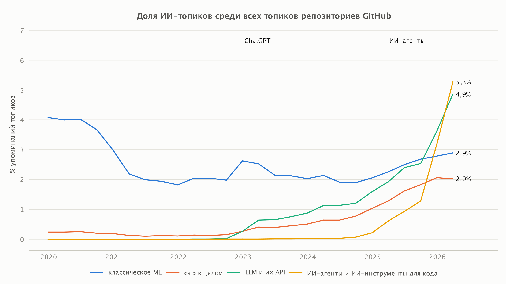
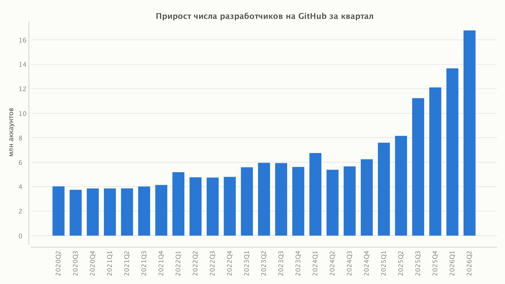

# Задача 1. Влияние ИИ на работу разработчиков на GitHub

*Черновик раздела статьи. Автор — С. Сухарев. Это первая часть задачи, на данных GitHub Innovation Graph. Вторая часть (события GH Archive и качество репозиториев) появится, когда будут готовы соответствующие сборщики.*

## 1.1. Постановка задачи

Как развитие ИИ изменило работу на GitHub: чем занимаются разработчики, сколько их и насколько активно они работают? Проверяем два события:

- **выход ChatGPT** (30 ноября 2022 года), начало массового использования больших языковых моделей (LLM);
- **появление ИИ-агентов для кода** (февраль–май 2025 года: агентный режим GitHub Copilot, Claude Code, OpenAI Codex). Это инструменты, которые сами пишут и отправляют изменения в репозитории.

Для каждого события смотрим, изменились ли после него темы репозиториев и показатели активности.

## 1.2. Данные

**GitHub Innovation Graph** [1], 2020Q1–2026Q2, по экономикам и кварталам:

- *developers* — аккаунты разработчиков в экономике на конец квартала (без ботов и спама);
- *repositories* — репозитории, отнесённые к экономике, на конец квартала;
- *git_pushes* — число пушей за квартал;
- *topics* — для каждого топика репозитория (метки вроде `python`, `llm`) число разработчиков, которые за квартал пушили в репозитории с этим топиком.

Метрики публикуются, только если действие выполнили не меньше 100 разработчиков экономики. Значения суммируются по всем экономикам, кроме агрегатов. Агрегат `EU` исключается по справочнику стран World Bank, иначе страны ЕС посчитались бы дважды. Загрузка и проверки описаны в README модулей `collector/innovation-graph` и `analytics-java`.

**Почему пуши, а не коммиты.** С 7 октября 2025 года GitHub перестал передавать число коммитов в событиях PushEvent своего Events API [2]. Поэтому в архиве событий (GH Archive) число коммитов после этой даты недоступно. Пуш — отправка одного или нескольких коммитов в репозиторий — единственная сопоставимая мера активности за весь период.

## 1.3. Метод

**Доля ИИ-топиков.** Для каждого квартала считаем, какую долю среди всех упоминаний топиков составляют ИИ-топики. Упоминание здесь — пара «разработчик, пушивший в репозиторий, — топик этого репозитория». 56 ИИ-топиков разбиты на четыре группы (полный список — `analytics-java/results/task1/ai_topic_groups.csv`):

- **классическое ML** — машинное обучение до LLM (`machine-learning`, `deep-learning`, `pytorch`, `computer-vision`, …);
- **«ai» в целом** — топики `ai` и `artificial-intelligence`;
- **LLM и их API** — `llm`, `openai`, `chatgpt`, `langchain`, `rag`, `claude`, `gemini`, `ollama`, …;
- **ИИ-агенты и ИИ-инструменты для кода** — `ai-agents`, `mcp`, `claude-code`, `cursor`, `copilot`, `vibe-coding`, …

Доля, а не абсолютное число, используется для того, чтобы общий рост GitHub и рост числа публикуемых топиков не выдавались за рост интереса к ИИ.

**Активность:**

- пушей на одного разработчика за квартал (числитель и знаменатель — по одним и тем же экономикам, где GitHub публикует пуши);
- прирост числа разработчиков за квартал. Innovation Graph даёт число аккаунтов на конец квартала, поэтому прирост чистый: новые аккаунты минус удалённые и «переехавшие». Это не число регистраций;
- репозиториев на одного разработчика.

**Сегментная регрессия (interrupted time series)** [3]:

  *y(t) = b0 + b1·t + b2·D(t) + b3·(t − k)·D(t)*,

где *t* — номер квартала, *k* — первый квартал после события, *D(t) = 1* начиная с *k*. Коэффициент *b2* — скачок уровня в момент события, *b3* — изменение наклона, то есть скорости роста за квартал. Окна:

- для ChatGPT — 2020Q1–2024Q4, первый квартал после события 2023Q1;
- для ИИ-агентов — 2023Q1–2026Q2, первый квартал после события 2025Q2.

Окно ChatGPT заканчивается до второй волны, чтобы она не приписывалась первому событию.

Соседние кварталы зависят друг от друга, и обычные стандартные ошибки МНК от этого получаются заниженными. Поэтому p-значения считаются по устойчивым к автокорреляции ошибкам Ньюи–Уэста [4] с двумя лагами. Для контроля приводится статистика Дарбина–Уотсона (*DW*) [5]: около 2 — автокорреляции нет, заметно меньше 2 — положительная автокорреляция.

Расчёт выполняет модуль `analytics-java` (SQL-запросы `task1/*.sql`, классы `AiActivity` и `SegmentedRegression`). Результаты лежат в `analytics-java/results/task1/`.

## 1.4. Результаты

### 1.4.1. Темы репозиториев

Доля ИИ-топиков с 2020 по 2022 год снижалась: с 4,3% в 2020Q1 до 1,9% в 2022Q1. После выхода ChatGPT она пошла вверх: 2,2% в 2022Q4, 3,2% в 2023Q1, 4,0% в 2024Q4, 8,3% в 2025Q4 и **15,1% в 2026Q2**. То есть сейчас примерно каждое седьмое упоминание топика относится к ИИ (рисунок 1.1).

На графике видны две волны:

- **топики LLM** появляются после ChatGPT: 0,02% в 2022Q4 и 4,9% в 2026Q2;
- **топики агентов и ИИ-инструментов для кода** почти не встречались до 2025 года (0,07% в 2024Q4), а к 2026Q2 стали самой крупной группой — 5,3%.

Классическое ML за весь период остаётся на уровне 2–3%.

*Рисунок 1.1. Доля ИИ-топиков среди всех упоминаний топиков репозиториев GitHub, по группам, 2020Q1–2026Q2*

**По странам** (рисунок 1.2; 26 стран, где за 2026Q2 не меньше 10 000 упоминаний топиков). Самая высокая доля ИИ-топиков у стран Восточной и Юго-Восточной Азии: Тайвань — 35,6%, Сингапур — 33,2%, Гонконг — 29,9%, Южная Корея — 28,3%, Китай — 27,4%. Далее идут Великобритания — 15,6%, США — 14,8%, Индия — 12,7%, Германия — 11,7%, Бразилия — 8,6%. **Россия на последнем месте — 7,4%.**

*Рисунок 1.2. Доля ИИ-топиков по странам, 2026Q2*

### 1.4.2. Активность

Число аккаунтов разработчиков выросло в 4,6 раза: с 45,5 млн (2020Q1) до 209,1 млн (2026Q2). Прирост за квартал (рисунок 1.3) был около 4 млн в 2020–2021 годах и 5–7 млн в 2023–2024 годах. В 2025 году он резко ускорился и в 2026Q2 достиг **16,8 млн**.

*Рисунок 1.3. Прирост числа разработчиков на GitHub за квартал, млн аккаунтов*

Пушей на одного разработчика с 2020 года становилось меньше: 1,78 в 2020Q1, минимум 1,15 в 2024Q3 (рисунок 1.4). Вероятная причина — быстрый рост числа аккаунтов, среди которых много малоактивных: знаменатель растёт быстрее числа пушей. С 2025 года тенденция развернулась: в 2026Q2 — **1,95** пуша на разработчика, больше, чем в 2020 году. Общее число пушей за пять кварталов выросло в 2,3 раза, с 177,7 млн в 2025Q1 до 407,6 млн в 2026Q2.

*Рисунок 1.4. Пушей на одного разработчика за квартал*

Репозиториев на одного разработчика становится меньше (2,69 в 2020Q1 → 2,17 в 2026Q2), и с 2025 года снижение ускорилось. По-видимому, новые аккаунты пока заводят мало своих репозиториев.

### 1.4.3. Проверка регрессией

*Таблица 1.1. Сегментная регрессия: наклон — изменение за квартал; p — по ошибкам Ньюи–Уэста; DW — статистика Дарбина–Уотсона*

| Ряд | Событие | Наклон до → после | Скачок уровня (p) | Изменение наклона (p) | DW |
|---|---|---|---|---|---|
| доля ИИ-топиков, п.п. | ChatGPT | −0,25 → +0,10 | +1,9 (p < 0,001) | +0,35 (p < 0,001) | 0,84 |
| доля LLM-топиков, п.п. | ChatGPT | 0,00 → +0,13 | +0,38 (p < 0,001) | +0,13 (p < 0,001) | 2,65 |
| пушей на разработчика | ChatGPT | −0,039 → −0,040 | +0,08 (p = 0,09) | 0,00 (p = 0,90) | 2,06 |
| прирост разработчиков, тыс. | ChatGPT | +123 → +31 | +768 (p < 0,001) | −92 (p = 0,03) | 2,38 |
| доля ИИ-топиков, п.п. | ИИ-агенты | +0,16 → +2,22 | +0,8 (p = 0,17) | +2,06 (p < 0,001) | 1,53 |
| доля топиков агентов, п.п. | ИИ-агенты | +0,02 → +1,16 | −0,2 (p = 0,69) | +1,14 (p < 0,001) | 1,57 |
| пушей на разработчика | ИИ-агенты | −0,034 → +0,158 | +0,10 (p = 0,21) | +0,19 (p < 0,001) | 1,48 |
| прирост разработчиков, тыс. | ИИ-агенты | +135 → +1967 | +1697 (p = 0,02) | +1831 (p < 0,001) | 2,48 |
| репозиториев на разработчика | ИИ-агенты | −0,016 → −0,054 | 0,00 (p = 0,50) | −0,039 (p < 0,001) | 1,24 |

Что показывает таблица.

**После ChatGPT:**

- доля ИИ-топиков разово подскочила на 1,9 процентного пункта, а её снижение сменилось ростом. Тот же сдвиг виден в LLM-топиках;
- число пушей на разработчика не изменилось ни по уровню (p = 0,09), ни по наклону (p = 0,90);
- прирост аккаунтов разово увеличился примерно на 0,8 млн за квартал.

**После появления ИИ-агентов:**

- значимо изменился наклон всех рядов: доли ИИ-топиков и топиков агентов, пушей на разработчика, прироста аккаунтов и репозиториев на разработчика (p < 0,001);
- пуши на разработчика, которые до этого снижались на 0,03 за квартал, стали расти на 0,16 за квартал.

## 1.5. Ограничения

1. **Топики есть не у всех репозиториев.** Innovation Graph публикует топик в стране, только если в репозитории с ним пушили не меньше 100 разработчиков. Поэтому доля ИИ-топиков — это доля среди размеченных репозиториев, а не среди всех.
2. **Один разработчик учитывается в каждом своём топике.** Поэтому сумма по топикам — число упоминаний, а не людей. На доли это не влияет, на абсолютные суммы — влияет.
3. **В 2026 году GitHub стал публиковать больше топиков** (1145 в 2025Q4 и 2072 в 2026Q2). Мы проверили, не создаёт ли это рост доли ИИ: если брать только топики, которые были опубликованы уже в 2025Q4, доля ИИ в 2026Q2 даже выше — 16,0% вместо 15,1%. Среди новых топиков ИИ-топиков всего 4,7%.
4. **Агенты пушат от имени людей.** ИИ-агенты отправляют изменения под аккаунтом пользователя, а GitHub исключает только аккаунты-боты. Значит, рост пушей на разработчика с 2025 года — частично работа самих агентов. Корректная формулировка: «с появлением ИИ-агентов активность аккаунтов выросла», а не «люди стали работать больше».
5. **Прирост аккаунтов — чистый**, он включает и удаление и пересчёт аккаунтов (п. 1.3).
6. **Ограничения регрессии.** Рядов немного (14–20 кварталов), сезонность не учитывается: летом активность ниже. Ошибки Ньюи–Уэста при такой длине ряда — приближение, поэтому p-значения — ориентир, а не строгий тест. Сильнее всего автокорреляция в доле ИИ-топиков вокруг ChatGPT (DW = 0,84) и в ряду репозиториев на разработчика (DW от 0,69 в окне ChatGPT до 1,24 в окне агентов); для них выводы нужно формулировать осторожнее.
7. **Совпадение во времени — не доказательство причины.** Регрессия показывает, что ряды меняются после событий, выбранных заранее по датам выхода продуктов. Но в те же периоды могли действовать и другие факторы: изменения в продуктах GitHub, экономическая ситуация, рост числа студентов-программистов.

## 1.6. Выводы

- ИИ стал заметной частью тематики GitHub: доля ИИ-топиков выросла с 2% в 2022 году до 15% в середине 2026-го.
- Видны две волны. ChatGPT в первую очередь изменил **то, чем занимаются** разработчики, — темы LLM, но не интенсивность работы. ИИ-агенты для кода (2025) изменили **и темы, и активность**: впервые за пять лет стало расти число пушей на разработчика, и резко ускорился приток аккаунтов.
- Страны различаются сильно: у Тайваня, Сингапура, Гонконга, Южной Кореи и Китая на ИИ приходится 27–36% упоминаний топиков, у России — 7,4%, это минимум среди 26 стран с наибольшим числом упоминаний топиков.

**Дальнейшая работа.** Добавить ряды событий GH Archive (пуши, создание репозиториев, pull request по месяцам, с разделением людей и ботов). Сравнить качество ИИ-репозиториев и остальных (наличие тестов, CI, Docker) по выборке `core.repos`, когда она будет собрана.

## Источники

1. GitHub Innovation Graph. — URL: https://github.com/github/innovationgraph (дата обращения: 16.11.2026).
2. GitHub Changelog. Upcoming changes to GitHub Events API payloads, 08.08.2025. — URL: https://github.blog/changelog/2025-08-08-upcoming-changes-to-github-events-api-payloads/ (дата обращения: 16.11.2026).
3. Wagner A. K., Soumerai S. B., Zhang F., Ross-Degnan D. Segmented regression analysis of interrupted time series studies in medication use research // Journal of Clinical Pharmacy and Therapeutics. — 2002. — Vol. 27, № 4. — P. 299–309.
4. Newey W. K., West K. D. A Simple, Positive Semi-Definite, Heteroskedasticity and Autocorrelation Consistent Covariance Matrix // Econometrica. — 1987. — Vol. 55, № 3. — P. 703–708.
5. Durbin J., Watson G. S. Testing for Serial Correlation in Least Squares Regression. I // Biometrika. — 1950. — Vol. 37, № 3/4. — P. 409–428.
