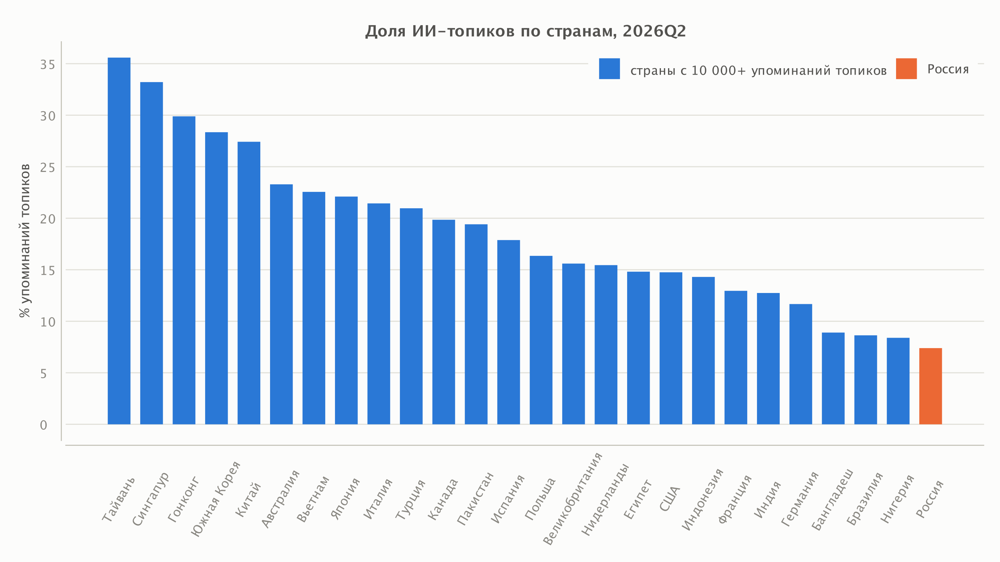
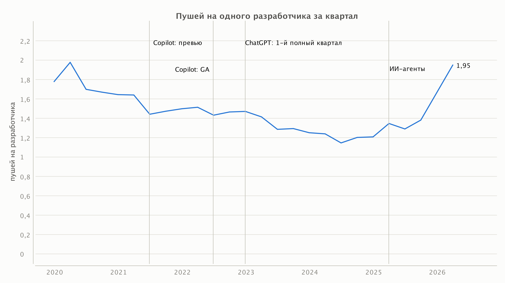

# Задача 1. Влияние ИИ на работу разработчиков на GitHub

*Черновик раздела статьи. Автор — С. Сухарев. Раздел описывает первый этап: динамику GitHub Innovation Graph за 2020Q1–2026Q2. Анализ событий GH Archive и признаков качества репозиториев будет отдельным продолжением; эти данные уже опубликованы командой.*

## 1.1. Постановка задачи

Как менялись тематика и активность аккаунтов GitHub в период распространения ИИ? Проверяем, совпали ли изменения временных рядов с тремя заранее выбранными событиями:

- **техническое превью GitHub Copilot** — 29 июня 2021 года;
- **выход ChatGPT** — 30 ноября 2022 года;
- **волна ИИ-агентов для кода** — февраль–май 2025 года: агентный режим Copilot, Claude Code и Codex.

Общий доступ к Copilot начался 21 июня 2022 года. Он отмечен на графиках, но отдельно не тестируется: между первым полным кварталом после этого события и после ChatGPT всего два квартала, поэтому квартальные данные плохо разделяют их возможные связи с динамикой GitHub.

Цель анализа — описать изменения и проверить устойчивость выбранных дат перелома. Причинный эффект использования ИИ по этим агрегатам установить нельзя.

## 1.2. Данные

**GitHub Innovation Graph** [1] содержит показатели по экономикам (странам и территориям) и кварталам. Использованы:

- *developers* — число аккаунтов разработчиков на конец квартала;
- *repositories* — число репозиториев, отнесённых GitHub к экономике, на конец квартала;
- *git_pushes* — число пушей за квартал;
- *topics* — число уникальных разработчиков экономики, которые за квартал пушили в репозитории с данным топиком, например `python` или `llm`.

Данные загружены в `core.innovation_graph` и `core.innovation_graph_topics` в PostgreSQL. В снимке 26 кварталов, 5927 строк «экономика × квартал» и 90 274 строки по топикам. Агрегат `EU` исключён через справочник стран World Bank: иначе экономики ЕС учитывались бы повторно. Показатели суммируются по опубликованным экономикам; число экономик с данными меняется по кварталам.

GitHub исключает известные ему аккаунты-боты и спам. Малые значения не публикуются: для топика в экономике требуется не менее 100 разработчиков. Отсутствующая метрика остаётся `NULL`, а не заменяется нулём.

**Пуши и коммиты различаются.** Один пуш может отправлять несколько коммитов. Здесь измеряется число пушей из Innovation Graph; оно не называется числом коммитов. GH Archive и история коммитов выбранных репозиториев — отдельные источники со своими ограничениями. Изменения GitHub Events API [2] не позволяют продолжить сопоставимый ряд коммитов GH Archive до конца рассматриваемого периода.

## 1.3. Метод

**Единица учёта топиков** — упоминание «разработчик × топик» за квартал, взвешенное опубликованным числом *pushers*. Если один разработчик пушил в репозитории с несколькими топиками, он учитывается в каждом из них. Поэтому сумма упоминаний не равна числу уникальных людей или репозиториев.

Основной показатель:

  *доля ИИ = сумма pushers ИИ-топиков / сумма pushers тематических топиков × 100%*.

**Служебные топики исключены из знаменателя.** В их число входят `config`, `github-config`, акции вроде Hacktoberfest, учебные задания, профили, портфолио и шаблоны. Их распространение меняется независимо от тематики разработки и без исключения создаёт ложный спад доли ИИ в 2020–2022 годах и завышенный скачок после ChatGPT. Правила находятся в `AiTopics.NON_THEMATIC`, список исключённых топиков — в `non_thematic_topics.csv`.

**Список ИИ-топиков** определяется правилами по словам названия с явными включениями и исключениями неоднозначных случаев. Например, `virtual-machine`, `state-machine`, радио LoRa и `apm-agent` не считаются ИИ только из-за совпадения части названия. В рассматриваемых данных проверено 206 кандидатов: 192 включены, 14 отклонены. Решения сохранены в `ai_topic_review.csv`, итоговый список — в `ai_topic_groups.csv`. Группы:

- **классическое ML — 31 топик:** `machine-learning`, `deep-learning`, `pytorch`, `computer-vision` и другие;
- **общий ИИ — 40:** `ai`, `artificial-intelligence`, `chatbot`, `ai-tools`, `ai-safety` и другие;
- **LLM и генеративный ИИ — 62:** `llm`, `openai`, `chatgpt`, `rag`, `claude`, `gemini`, `deepseek`, `embeddings`, `stable-diffusion` и другие;
- **агенты и инструменты для кода — 59:** `ai-agents`, `mcp`, `claude-code`, `codex`, `cursor`, `copilot`, `langgraph`, `vibe-coding` и другие.

Проверочный показатель — **ИИ-упоминаний на 1000 аккаунтов разработчиков**. Он не зависит от количества упоминаний остальных топиков, но остаётся чувствительным к порогу публикации GitHub и полноте набора топиков.

**Сравнение стран.** Собственные списки опубликованных топиков несопоставимы: в 2026Q2 тематических топиков у США 1683, у России 85. Сначала отобраны 25 экономик с не менее чем 10 000 тематических упоминаний по собственному списку, затем взято пересечение их топиков. Доли для всех стран рассчитаны на одном наборе из 22 топиков, из которых пять относятся к ИИ: `ai`, `ai-agents`, `claude-code`, `llm`, `rag`. Список сохранён в `ai_topics_by_country_common_topics.csv`. Это сравнение популярных общих тем, а не полного объёма ИИ-разработки каждой страны.

**Показатели активности:**

- пушей на аккаунт за квартал: числитель и знаменатель берутся по одним экономикам, где GitHub публикует пуши;
- чистый прирост числа аккаунтов за квартал: изменение запаса аккаунтов, включая новые, удалённые, помеченные как спам и сменившие страну; это не число регистраций;
- репозиториев на аккаунт.

**Сегментная регрессия (interrupted time series)** [3]:

  *y(t) = b0 + b1·t + b2·D(t) + b3·(t − k)·D(t)*,

где *t* — номер квартала, *k* — выбранный квартал перелома, *D(t) = 1* начиная с *k*. Коэффициент *b2* оценивает изменение уровня в квартале перелома, *b3* — изменение наклона. Используются отдельные окна:

- превью Copilot: 2020Q1–2022Q4, перелом в 2021Q3 — первом полном квартале после превью;
- ChatGPT: 2020Q1–2024Q4, перелом в 2023Q1 — первом полном квартале после выхода;
- ИИ-агенты: 2023Q1–2026Q2, выбран 2025Q2 как квартал волны релизов.

Окно ChatGPT заканчивается до волны агентов. p-значения рассчитаны по устойчивым к автокорреляции ошибкам Ньюи–Уэста [4] с двумя лагами. Рядом приводится статистика Дарбина–Уотсона (*DW*) [5]: значение около 2 не указывает на выраженную автокорреляцию первого порядка.

**Placebo-проверка дат.** В каждом окне модель повторяется для других кварталов перелома с минимум тремя наблюдениями по обе стороны. Для уровня и наклона отдельно считается доля альтернативных дат с таким же или меньшим p-значением, чем у события. Если похожий перелом находится на многих датах, привязка именно к выбранному событию неустойчива. Это диагностическая проверка, а не доказательство причинности.

Расчёты выполняет модуль `analytics-java`: SQL `task1/*.sql`, классы `AiActivity`, `AiTopics`, `SegmentedRegression`. В `results/task1/` сохранены исходные для графиков агрегаты, 17 событийных регрессий и 160 placebo-регрессий. Графики строятся тем же запуском программы.

## 1.4. Результаты

### 1.4.1. ИИ-тематика

После исключения служебных топиков доля ИИ в 2020–2022 годах почти не менялась: **4,6% в 2020Q1 и 4,0% в 2022Q4**. С 2023 года она растёт: 4,4% в 2023Q1, 5,7% в 2023Q4, 7,2% в 2024Q4, 9,7% в 2025Q2, 11,3% в 2025Q4 и **19,8% в 2026Q2** (рисунок 1.1).

Виден разный ход четырёх групп. Доля LLM и генеративного ИИ выросла с 0,08% в 2022Q4 до **6,3%** в 2026Q2. Доля агентов и инструментов для кода — с 0,12% в 2024Q4 до **6,9%** в 2026Q2. Классическое ML оставалось примерно на уровне 3,4–4,5%; его доля в последнем квартале — 3,5%, общего ИИ — 3,1%.

*Рисунок 1.1. Доля ИИ среди тематических упоминаний: всего и четыре группы, 2020Q1–2026Q2. Вертикальные линии отмечают выбранные кварталы событий; GA Copilot показан справочно.*

ИИ-упоминаний на 1000 аккаунтов в 2020–2024 годах было около 0,4 (0,36–0,52), в 2025Q4 — 0,63, в 2026Q2 — **2,19**. Этот рост не может быть вызван только изменением количества упоминаний не-ИИ-топиков.

**По странам на общем наборе топиков** (рисунок 1.2): Сингапур — 37,1%, Гонконг — 35,2%, Тайвань — 32,4%, Китай — 32,1%, Южная Корея — 29,9%, Япония — 29,8%, **США — 29,5%, 7-е место**. Германия — 19,8%, Индия — 19,4%, Франция — 19,0%. **Россия — 14,3%, 23-е место из 25**, Бразилия — 13,3%, Бангладеш — 13,0%.

По собственным спискам топиков доли США и России составляли бы 20,6% и 8,2%; такие значения чувствительны к различиям длины списков и не используются для ранжирования стран.

*Рисунок 1.2. Доля ИИ-упоминаний на общем наборе из 22 топиков для 25 экономик, 2026Q2. Россия выделена цветом.*

### 1.4.2. Активность

Сумма аккаунтов разработчиков по опубликованным экономикам выросла в **4,6 раза**: с 45,5 млн в 2020Q1 до 209,1 млн в 2026Q2. Чистый прирост за квартал был около 4 млн в 2020–2021 годах, 5–7 млн в 2023–2024 годах; с 2025 года рост ускорился, и в 2026Q2 прирост достиг **16,8 млн** (рисунок 1.3).

*Рисунок 1.3. Чистый прирост числа аккаунтов разработчиков за квартал, млн; не число регистраций.*

Пушей на аккаунт становилось меньше: с 1,78 в 2020Q1 до минимума **1,15 в 2024Q3**. С 2025 года ряд растёт и достигает **1,95 в 2026Q2** (рисунок 1.4). Всего пушей между 2025Q1 и 2026Q2 стало в 2,3 раза больше: 177,7 млн → 407,6 млн. Сам по себе этот показатель не разделяет ручную работу и автоматизацию под пользовательским аккаунтом.

*Рисунок 1.4. Пушей на аккаунт за квартал. Для числителя и знаменателя используются одни экономики; линия ChatGPT соответствует первому полному кварталу после выхода.*

Репозиториев на аккаунт стало меньше: 2,69 в 2020Q1 → 2,17 в 2026Q2. Это отношение двух агрегатов; оно не позволяет установить, сколько репозиториев заводят именно новые пользователи.

### 1.4.3. Регрессии и устойчивость дат

*Таблица 1.1. Сегментные регрессии. Наклоны — изменение показателя за квартал; p — по Ньюи–Уэсту; placebo — доля альтернативных дат с таким же или меньшим p для уровня / наклона. Все 17 моделей приведены в порядке `event_regressions.csv`.*

| Ряд | Событие | Наклон до → после | Скачок уровня (p) | Изменение наклона (p) | DW | Placebo: уровень / наклон |
|---|---|---|---|---|---|---|
| доля ИИ, п.п. | Превью Copilot | −0,07 → −0,08 | +0,05 (p = 0,69) | −0,01 (p = 0,74) | 2,38 | 0,83 / 0,67 |
| доля ИИ, п.п. | ChatGPT | −0,07 → +0,36 | +0,80 (p < 0,001) | +0,43 (p < 0,001) | 2,62 | 0,07 / 0,07 |
| доля ИИ, п.п. | ИИ-агенты | +0,40 → +2,50 | +0,17 (p = 0,86) | +2,11 (p < 0,001) | 1,58 | 1,00 / 0,50 |
| ИИ-упоминаний на 1000 аккаунтов | Превью Copilot | −0,011 → −0,007 | −0,015 (p = 0,57) | +0,004 (p = 0,66) | 1,91 | 0,67 / 0,67 |
| ИИ-упоминаний на 1000 аккаунтов | ChatGPT | −0,011 → −0,004 | +0,098 (p < 0,001) | +0,007 (p = 0,03) | 2,07 | 0,00 / 0,50 |
| ИИ-упоминаний на 1000 аккаунтов | ИИ-агенты | −0,001 → +0,391 | −0,167 (p = 0,46) | +0,392 (p = 0,003) | 1,59 | 0,88 / 0,25 |
| доля LLM, п.п. | ChatGPT | +0,00 → +0,25 | +0,54 (p < 0,001) | +0,25 (p < 0,001) | 2,55 | 0,07 / 0,14 |
| доля агентов, п.п. | ИИ-агенты | +0,03 → +1,46 | −0,15 (p = 0,81) | +1,44 (p < 0,001) | 1,55 | 1,00 / 0,25 |
| пушей на аккаунт | Превью Copilot | −0,049 → +0,000 | −0,093 (p = 0,09) | +0,050 (p = 0,007) | 2,82 | 0,33 / 0,33 |
| пушей на аккаунт | ChatGPT | −0,039 → −0,040 | +0,082 (p = 0,09) | −0,001 (p = 0,90) | 2,06 | 0,29 / 0,93 |
| пушей на аккаунт | ИИ-агенты | −0,034 → +0,158 | +0,100 (p = 0,21) | +0,191 (p < 0,001) | 1,48 | 0,25 / 0,88 |
| прирост аккаунтов, тыс. | Превью Copilot | −22 → +152 | +425 (p = 0,14) | +174 (p = 0,03) | 2,13 | 0,40 / 0,40 |
| прирост аккаунтов, тыс. | ChatGPT | +123 → +31 | +768 (p < 0,001) | −92 (p = 0,03) | 2,38 | 0,08 / 0,54 |
| прирост аккаунтов, тыс. | ИИ-агенты | +135 → +1967 | +1697 (p = 0,02) | +1831 (p < 0,001) | 2,48 | 0,38 / 0,25 |
| репозиториев на аккаунт | Превью Copilot | −0,019 → −0,007 | +0,037 (p = 0,03) | +0,012 (p = 0,01) | 1,58 | 0,50 / 0,50 |
| репозиториев на аккаунт | ChatGPT | −0,009 → −0,016 | −0,011 (p = 0,27) | −0,006 (p = 0,04) | 0,69 | 0,93 / 0,36 |
| репозиториев на аккаунт | ИИ-агенты | −0,016 → −0,054 | −0,005 (p = 0,50) | −0,039 (p < 0,001) | 1,24 | 1,00 / 0,12 |

**ChatGPT.** С выходом ChatGPT совпало изменение ИИ-тематики: модель оценивает скачок на 0,80 п.п. и смену наклона с −0,07 на +0,36 п.п. за квартал. Для суммарной доли ИИ только 1 из 14 альтернативных дат (7%) даёт такой же или меньший p как для уровня, так и для наклона. У LLM-топиков выделяется изменение уровня; у ИИ-упоминаний на 1000 аккаунтов ни одна из 14 альтернативных дат не даёт столь малого p для скачка. Это поддерживает временное совпадение роста ИИ-тематики с выходом ChatGPT, сохраняя ограничения наблюдательного анализа.

Для пушей на аккаунт модель не выявила убедительного изменения уровня или наклона около ChatGPT (p = 0,09 и 0,90); отсутствие такого результата не доказывает полного отсутствия эффекта. Скачок чистого прироста аккаунтов оценивается в +768 тыс.; сопоставимое p для уровня встречается у 1 из 13 альтернативных дат (8%).

**Превью Copilot.** Изменения ИИ-доли не выделяются ни по p, ни по placebo. Для пушей на аккаунт изменение наклона имеет p = 0,007, но сопоставимый результат находится у трети альтернативных дат. Поэтому привязывать остановку снижения пушей именно к превью Copilot по этим данным нельзя.

**ИИ-агенты.** В период с 2025 года ускорились рост доли ИИ и агентов, пушей на аккаунт и прироста аккаунтов. При выбранном переломе 2025Q2 p для изменения наклона малы, но placebo существенно ограничивает интерпретацию: для наклона ИИ-доли сопоставимое p встречается у 50% альтернативных дат, для доли агентов — у 25%, для пушей — у 88%, для прироста аккаунтов — у 25%. Точную дату перелома 2025Q2 выделить нельзя: ускорение распределено во времени.

## 1.5. Ограничения

1. **Упоминания, а не люди и репозитории.** Доли взвешены числом *pushers* каждого топика. Разработчик с несколькими топиками учитывается несколько раз; топики есть не у всех репозиториев. Поэтому 19,8% не означает такую долю всех репозиториев или пользователей GitHub.
2. **Порог публикации и меняющийся охват.** Число тематических топиков выросло с 1117 в 2025Q4 до 2045 в 2026Q2. Проверка на фиксированном списке топиков 2025Q4 дала 20,0% вместо 19,8%. Более строгая проверка на фиксированных парах «страна × топик» дала **17,4%**: часть роста связана с преодолением порога 100 разработчиков в новых странах. Эти дополнительные проверки воспроизведены С. Рушкевичем при ревью [6]; они не являются отдельными столбцами опубликованных агрегатных CSV. Показатель на 1000 аккаунтов также чувствителен к расширению публикации.
3. **Правила классификации топиков.** Служебные и ИИ-топики определяются по названиям и заданным исключениям. Результаты зависят от этой классификации; списки решений открыты для проверки.
4. **Сравнение стран ограничено 22 общими топиками**, включая пять ИИ-топиков. Оно описывает распространённые темы внутри выбранных 25 экономик. Определение страны по IP также ограничивает интерпретацию.
5. **Активность аккаунтов не равна работе людей.** Инструменты автоматизации и ИИ-агенты могут отправлять изменения под обычными пользовательскими аккаунтами. Данные не выделяют такие пуши и не позволяют оценить их долю.
6. **Короткие ряды.** В отдельных моделях 11–20 наблюдений; до превью Copilot всего шесть кварталов исходного ряда, до ChatGPT — 12. Более ранний тренд Innovation Graph не показывает. Сезонность и другие факторы не включены; ошибки Ньюи–Уэста — приближение, проверяется много эффектов без поправки на множественные сравнения. p-значения и placebo следует читать вместе с графиками, а не как самостоятельное доказательство.
7. **Причинность не установлена.** События выбраны по датам релизов, но параллельно могли меняться состав пользователей, продукты GitHub и внешние условия. Placebo проверяет устойчивость дат, не устраняет эти смешивающие факторы.

## 1.6. Выводы

- Доля ИИ среди опубликованных тематических упоминаний почти не менялась в 2020–2022 годах, затем выросла с 4,0% в 2022Q4 до **19,8% в 2026Q2**. Рост связан прежде всего с LLM и агентными инструментами; доля классического ML относительно стабильна.
- Рост ИИ-тематики **совпал по времени с выходом ChatGPT** и выделяется относительно большинства альтернативных дат. Убедительного изменения пушей на аккаунт около этого события выбранная модель не выявила.
- **С 2025 года, в период распространения ИИ-агентов, рост ускорился**, но данные не выделяют точный перелом в 2025Q2. Приписывать ускорение самим агентам или утверждать рост ручной производительности нельзя.
- На общем наборе топиков Россия имеет 14,3% ИИ-упоминаний, 23-е место из 25; США — 29,5%, 7-е. Это сравнение выбранных общих тем, а не рейтинг всех ИИ-разработчиков.

**Дальнейшая работа.** Проанализировать уже опубликованные ряды событий GH Archive, учитывая разрывы источника после мая 2025 года. На выборке `core.repos` сравнить наблюдаемые признаки качества — тесты, CI, Docker — с учётом возраста репозиториев и весов выборки. Эти результаты в настоящий раздел ещё не включены.

## Источники

1. [GitHub Innovation Graph](https://github.com/github/innovationgraph) (дата обращения: 16.11.2026).
2. [GitHub Changelog. Upcoming changes to GitHub Events API payloads, 08.08.2025](https://github.blog/changelog/2025-08-08-upcoming-changes-to-github-events-api-payloads/) (дата обращения: 16.11.2026).
3. Wagner A. K., Soumerai S. B., Zhang F., Ross-Degnan D. Segmented regression analysis of interrupted time series studies in medication use research // Journal of Clinical Pharmacy and Therapeutics. — 2002. — Vol. 27, № 4. — P. 299–309.
4. Newey W. K., West K. D. A Simple, Positive Semi-Definite, Heteroskedasticity and Autocorrelation Consistent Covariance Matrix // Econometrica. — 1987. — Vol. 55, № 3. — P. 703–708.
5. Durbin J., Watson G. S. Testing for Serial Correlation in Least Squares Regression. I // Biometrika. — 1950. — Vol. 37, № 3/4. — P. 409–428.
6. [Рушкевич С. Ревью PR #23, 17.11.2026: проверки на фиксированных топиках и парах «страна × топик»](https://github.com/ssukharev/GitHub_BigData2026/pull/23#pullrequestreview-5937892076) (дата обращения: 22.11.2026).
