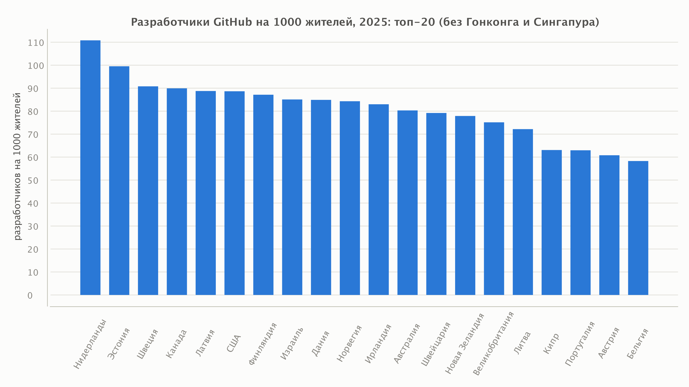
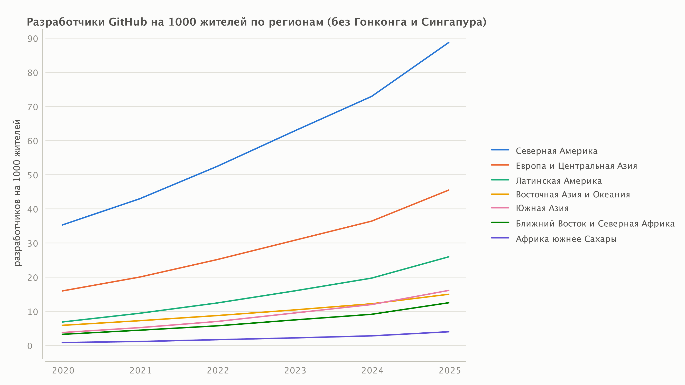
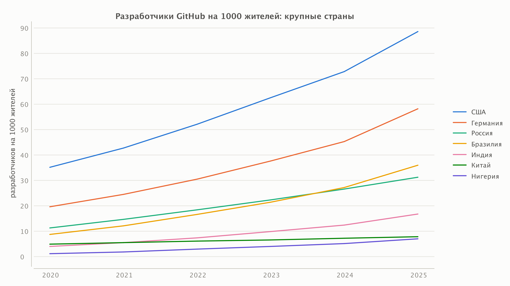

# Задача 3. Разработчики GitHub относительно населения стран

*Черновик раздела статьи. Автор — С. Сухарев. Нумерацию рисунков, таблиц и источников при сборке статьи нужно согласовать с остальными разделами.*

## 3.1. Постановка задачи

В каких странах разработчиков GitHub больше всего относительно населения? Насколько сильно различаются регионы мира и как этот показатель менялся с 2020 по 2025 год? Абсолютные числа здесь мало что говорят: в США и Индии разработчиков много уже потому, что там много людей. Поэтому сравниваем страны по числу разработчиков на 1000 жителей.

## 3.2. Данные

**GitHub Innovation Graph** [1] — открытый набор данных GitHub с метриками по экономикам (странам и территориям) по кварталам с 2020 года. Для задачи взята метрика *developers*: число аккаунтов разработчиков, которые GitHub относит к экономике на последний день квартала. Страна определяется по IP-адресу: берётся то место, где аккаунт чаще всего находился по дням. Боты и аккаунты, помеченные как спам, исключены. Метрика публикуется, только если в экономике не меньше 100 разработчиков. Период — 2020Q1–2026Q2.

**World Bank, индикатор SP.POP.TOTL** [2] — численность населения по странам и годам. Данные есть по 2025 год включительно (обновление от 08.10.2026).

Оба источника загружаются в PostgreSQL сборщиками проекта (`collector/innovation-graph`, `collector/worldbank`) в таблицы `core.innovation_graph`, `core.population` и `core.countries`. Страны сопоставляются по двухбуквенному коду ISO 3166-1:

- 79 записей World Bank — агрегаты («Мир», «Евросоюз», группы по доходу). Они в расчёт не входят. В Innovation Graph тоже есть агрегат — Евросоюз (`EU`), и его тоже исключаем, иначе разработчики стран ЕС были бы посчитаны дважды.
- 20 экономик Innovation Graph отсутствуют в World Bank, в основном заморские территории. Из заметных — только Тайвань: 1,74 млн аккаунтов в 2025 году. Без населения они в расчёт не попадают.

В итоге за 2025 год в расчёте 213 стран: 176,9 млн аккаунтов на 8,17 млрд жителей.

## 3.3. Метод

Показатель страны *c* в год *y*:

  *d(c, y) = developers(c, IV квартал y) / population(c, y) × 1000*.

Число разработчиков берётся на конец IV квартала, население — того же года. Так обе величины относятся к одному году. Дальше:

- **рейтинг за 2025 год и рост за 2020–2025 годы** считаются только по странам с населением от 1 млн. В микрогосударствах несколько тысяч аккаунтов дают значения, которые ничего не говорят о стране: например, на Сейшелах выходит 173,5 на 1000 жителей. В рейтинге 159 стран, в расчёте роста — 158;
- **по регионам World Bank** показатель считается как сумма разработчиков, делённая на сумму населения, а не как среднее по странам. Поэтому крупные страны весят больше. Гонконг и Сингапур в регионы не включены (см. п. 3.5);
- **рост** — отношение *d(c, 2025) / d(c, 2020)*.

Расчёт выполняет модуль `analytics-java` (SQL-запрос `per_capita.sql` и класс `PerCapita`). Таблицы результатов лежат в `analytics-java/results/task3/`.

## 3.4. Результаты

**Мир в целом.** В 2025 году на 1000 жителей приходится 21,7 аккаунта GitHub (по 213 странам с данными). Медиана по 159 странам с населением от 1 млн — 19,0.

**Лидеры.** Первые два места по формальному показателю занимают Гонконг (435,0) и Сингапур (318,1). Их значения объясняются способом определения страны, а не числом жителей-разработчиков (п. 3.5). Без них первая десятка такая (таблица 3.1, рисунок 3.1).

*Таблица 3.1. Разработчики GitHub на 1000 жителей, 2025 год (страны от 1 млн жителей, без Гонконга и Сингапура)*

| Место | Страна | На 1000 жителей |
|---|---|---|
| 1 | Нидерланды | 110,8 |
| 2 | Эстония | 99,5 |
| 3 | Швеция | 90,8 |
| 4 | Канада | 89,9 |
| 5 | Латвия | 88,8 |
| 6 | США | 88,6 |
| 7 | Финляндия | 87,1 |
| 8 | Израиль | 85,1 |
| 9 | Дания | 84,9 |
| 10 | Норвегия | 84,3 |

*Рисунок 3.1. Топ-20 стран по числу разработчиков GitHub на 1000 жителей, 2025 год (без Гонконга и Сингапура)*

Лидируют небольшие богатые страны Северной Европы, а также США и Канада. У стран с самым низким показателем он меньше одного аккаунта на 1000 жителей: Центральноафриканская Республика — 0,13, Чад — 0,27, Нигер — 0,30.

**Крупные страны** (место в рейтинге из 159 с учётом Гонконга и Сингапура): США — 88,6 (8-е место), Великобритания — 75,1 (17-е), Германия — 58,2 (23-е), Франция — 54,7 (25-е), Япония — 40,3 (44-е), Бразилия — 36,0 (49-е), **Россия — 31,3 (55-е)**, Индия — 16,8 (85-е), Китай — 7,9 (108-е), Нигерия — 7,1 (109-е).

**Регионы** (таблица 3.2, рисунок 3.2). Разрыв между регионами огромный: в Северной Америке на 1000 жителей приходится в 22 раза больше разработчиков, чем в Африке южнее Сахары.

*Таблица 3.2. Разработчики GitHub на 1000 жителей по регионам World Bank (без Гонконга и Сингапура)*

| Регион | 2020 | 2025 | Рост, раз |
|---|---|---|---|
| Северная Америка | 35,3 | 88,8 | 2,5 |
| Европа и Центральная Азия | 16,0 | 45,5 | 2,8 |
| Латинская Америка и Карибский бассейн | 6,9 | 26,0 | 3,8 |
| Южная Азия | 3,8 | 16,1 | 4,2 |
| Восточная Азия и Тихоокеанский регион | 5,9 | 15,0 | 2,5 |
| Ближний Восток, Северная Африка, Афганистан и Пакистан | 3,3 | 12,5 | 3,8 |
| Африка южнее Сахары | 0,9 | 4,0 | 4,6 |

*Рисунок 3.2. Разработчики GitHub на 1000 жителей по регионам World Bank, 2020–2025 годы*

**Динамика** (рисунок 3.3). За пять лет показатель вырос почти везде. Медианный рост по 158 странам — в 3,8 раза. Быстрее всего растут страны с очень низким стартом: Южный Судан — в 12,6 раза, Чад — в 10,6, Республика Конго — в 10,3. Из стран с заметной базой выделяется Узбекистан: 1,2 → 9,4, в 7,7 раза. Медленнее всех растёт Китай: 4,9 → 7,9, всего в 1,6 раза. Россия выросла в 2,8 раза (11,3 → 31,3), США — в 2,5, Германия — в 3,0, Бразилия — в 4,1, Индия — в 4,2, Нигерия — в 5,9. В 2024 году Бразилия обогнала Россию (27,2 против 26,6), а в 2025-м разрыв вырос: 36,0 против 31,3.

*Рисунок 3.3. Разработчики GitHub на 1000 жителей в крупных странах, 2020–2025 годы*

## 3.5. Ограничения

1. **Страна определяется по IP-адресу.** VPN, прокси и офисы международных компаний переносят аккаунты в другие экономики. Самый явный пример — Гонконг и Сингапур: 435 и 318 аккаунтов на 1000 жителей невозможно объяснить местными разработчиками. Мы оставили их в таблице рейтинга, но исключили из графиков топа и из регионов: с ними Восточная Азия получается 17,1 на 1000 вместо 15,0. По той же причине может быть занижена доля стран, где VPN используют массово.
2. **Аккаунты, а не люди.** Метрика считает все аккаунты, отнесённые к стране, а не активных разработчиков. У одного человека может быть несколько аккаунтов, неактивные аккаунты тоже учитываются. Поэтому рост в 2–5 раз за пять лет — это и приток новых людей, и накопление аккаунтов.
3. **GitHub — не единственная платформа.** В Китае заметная часть разработчиков работает на других площадках (например, Gitee), поэтому низкий показатель Китая описывает присутствие на GitHub, а не число программистов.
4. **Пропуски.** Тайвань (1,74 млн аккаунтов) не входит в расчёт: World Bank не публикует его население. Экономики, где меньше 100 разработчиков, GitHub не публикует.
5. **Разные моменты измерения.** Разработчики берутся на конец года, население World Bank — оценка за год. Для сравнения стран это несущественно, для точных значений — небольшая неточность.

## 3.6. Выводы

- В 2025 году на 1000 жителей мира приходится около 22 аккаунтов GitHub. Разброс между странами — три порядка: от 0,1 до 110 (без Гонконга и Сингапура).
- Лидируют Северная Европа, Нидерланды, США и Канада: 85–110 разработчиков на 1000 жителей. Россия с показателем 31,3 — на 55-м месте из 159, между Бразилией (36,0) и Индией (16,8).
- За 2020–2025 годы показатель вырос у большинства стран (124 из 158) в 2–5 раз, медиана — в 3,8 раза. Сильнее всего растут страны с низкой базой, поэтому разрыв в относительных величинах сокращается, но в абсолютных — растёт.
- Метрика GitHub чувствительна к способу определения страны (IP-адреса). Для небольших экономик-хабов её нужно интерпретировать осторожно.

## Источники

1. GitHub Innovation Graph. — URL: https://github.com/github/innovationgraph (дата обращения: 16.11.2026).
2. World Bank Open Data. Population, total (SP.POP.TOTL). — URL: https://data.worldbank.org/indicator/SP.POP.TOTL (дата обращения: 16.11.2026).
